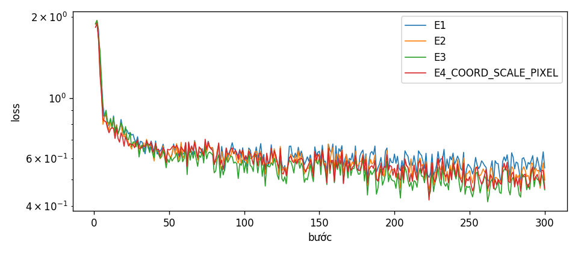
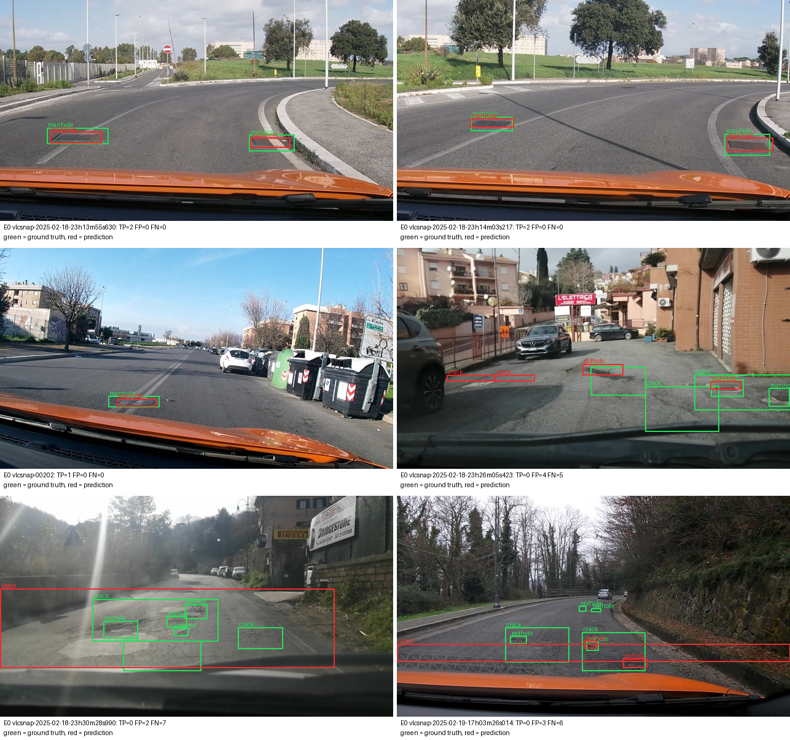
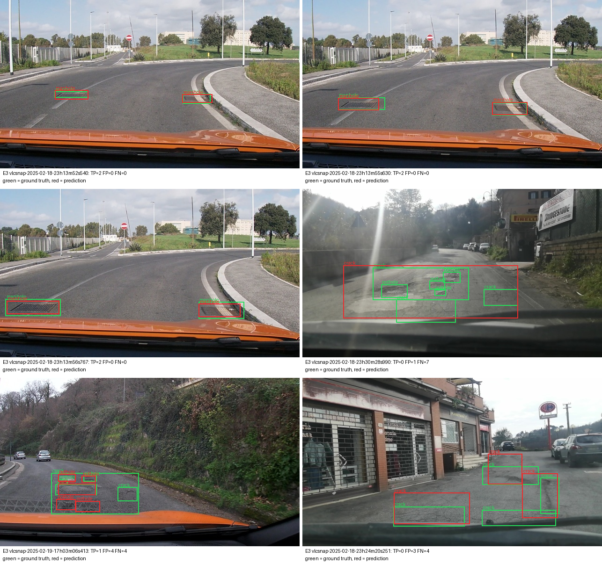
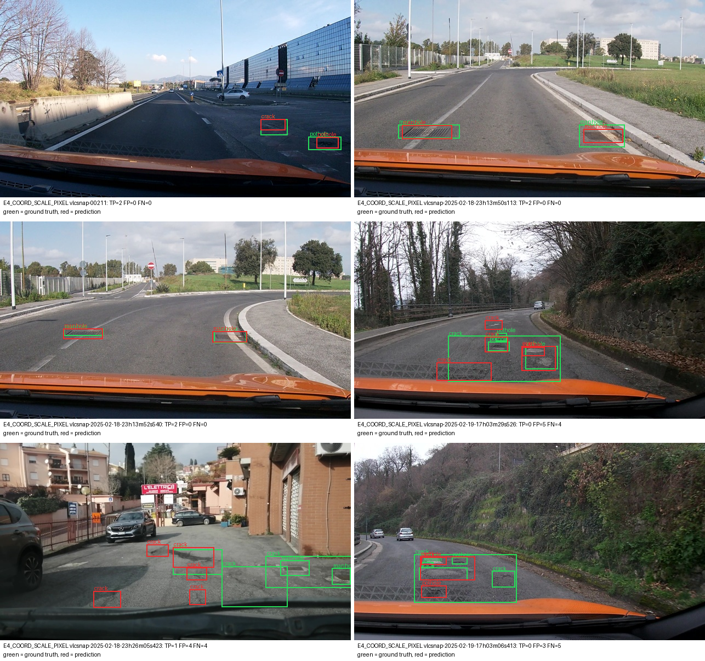
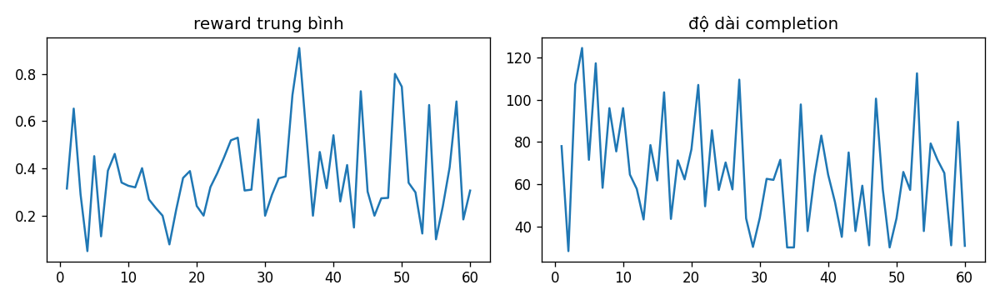

Họ tên: Đoàn Duy Bách
MSSV: 2A202602515
`dataset_version`: d10-21e4070301

Cách chạy lại: mã nằm trong `lab/` (`labels.py`, `vlm.py`, `run.py`, `reward.py`, `grpo.py`, `viz.py`, `summarize.py`), test của mình ở `lab/tests/` (`python -m pytest -q lab/tests`). Số liệu dưới đây chạy bằng `lab_day10_kaggle.ipynb` (đã lưu kèm output) trên **Kaggle 2 × Tesla T4**. Mỗi thí nghiệm dùng một T4 riêng, hai thí nghiệm chạy song song. Lý do: Colab miễn phí hết hạn mức GPU giữa lúc đang train E1. `lab_day10.ipynb` là bản Colab của cùng quy trình, đã chạy được E0 (F1 0,117 so với 0,116 trên Kaggle).
Thư viện: torch 2.11.0+cu128, transformers 5.19.0, peft 0.21.2, trl 1.9.2, bitsandbytes 0.50.2. Log, `run.json` và dự đoán thô của từng thí nghiệm nằm trong `report/runs/`.

## Bảng tổng hợp (số của bạn, lấy từ `report/evidence/*.json`)

VRAM đỉnh = `torch.cuda.max_memory_allocated` lúc train. Phút = thời gian train 300 bước (chưa tính suy luận).

| Mã | Setup | Tham số huấn luyện | VRAM đỉnh (GB) | Phút | F1 | CI95 | FP/ảnh | F1 pothole | F1 crack | F1 manhole |
|---|---|---|---|---|---|---|---|---|---|---|
| E0 | zero-shot | 0 | – | – | 0,116 | 0,088–0,145 | 0,96 | 0,133 | 0,039 | 0,255 |
| E1 | LoRA LLM | 33,0M | 6,59 | 49,0 | 0,252 | 0,216–0,290 | 1,31 | 0,173 | 0,180 | 0,516 |
| E2 | + projector | 142,1M | 8,28 | 46,5 | 0,308 | 0,268–0,349 | 1,12 | 0,148 | 0,234 | 0,593 |
| E3 | + LoRA ViT | 148,4M | 8,46 | 57,8 | **0,446** | 0,405–0,487 | 0,86 | 0,303 | 0,376 | 0,697 |
| E4 | `coord_scale = norm1000` (chính là E3) | 148,4M | 8,46 | 57,8 | 0,446 | 0,405–0,487 | 0,86 | 0,303 | 0,376 | 0,697 |
| E4 | `coord_scale = pixel` (E3 + nhãn/prompt pixel) | 148,4M | 8,45 | 57,8 | 0,407 | 0,367–0,445 | 1,00 | 0,261 | 0,336 | 0,669 |
| E5 | GRPO 60 bước, khởi tạo từ E3 | 39,3M (chỉ LoRA) | 5,53 | 21,2 | 0,440 | 0,397–0,482 | 0,86 | 0,309 | 0,365 | 0,682 |

`parse_valid_rate`: E0 0,949 · E1 0,994 · E2 1,000 · E3 1,000 · E4-pixel 0,994 · E5 1,000.

Bootstrap **ghép cặp** theo ảnh (2.000 lần, lấy mẫu lại cùng một tập ảnh cho cả hai setup; chạy lại bằng `python -m lab.analyze`, dùng hàm của `scripts/score.py`):

| So sánh | ΔF1 | CI95 của ΔF1 | P(Δ ≤ 0) |
|---|---|---|---|
| E1 − E0 | +0,137 | +0,101 … +0,173 | 0,000 |
| E2 − E1 | +0,055 | +0,019 … +0,093 | 0,003 |
| E3 − E2 | +0,139 | +0,100 … +0,176 | 0,000 |
| E3 − E1 | +0,194 | +0,155 … +0,234 | 0,000 |
| E3 (norm1000) − E4 pixel | +0,040 | +0,000 … +0,078 | 0,024 |
| E5 − E3 | −0,007 | −0,024 … +0,010 | 0,787 |

Đường loss (loss chỉ tính trên phần trả lời):



Ảnh minh hoạ (mỗi file 6 ảnh: 3 đúng nhiều nhất, 3 sai nhiều nhất, xanh = nhãn đúng, đỏ = dự đoán, kèm TP/FP/FN): `report/figures/e{0,1,2,3,5}_examples.png`, `e4_coord_scale_pixel_examples.png`.

## 10 câu hỏi (trả lời bằng **số của bạn**, không chép lại tài liệu)

### Câu 1 — Kiến trúc: ViT, projector và LLM của Qwen3-VL-4B có bao nhiêu tham số mỗi khối, và E1/E2/E3 mỗi cái cập nhật khối nào?

Đếm trên cây module thật của `Qwen/Qwen3-VL-4B-Instruct` (transformers 5.19, dựng trên meta device):

| Khối | Tên module | Tham số |
|---|---|---|
| ViT (tổng) | `model.visual` | 415,3M |
| └ 24 khối transformer | `model.visual.blocks` | 302,3M |
| └ projector chính | `model.visual.merger` | 27,3M |
| └ projector DeepStack (lớp 5, 11, 17) | `model.visual.deepstack_merger_list` | 81,8M |
| └ patch_embed + pos_embed | | 3,9M |
| LLM (36 lớp, kể cả embedding 389,0M) | `model.language_model` | 4.022,5M |
| `lm_head` | dùng chung trọng số với `embed_tokens` | (0) |
| **Tổng** | | **4.437,8M** |

Khối được cập nhật (số tham số khớp `meta.trainable_params` trong file bằng chứng):

- **E1**: chỉ LoRA r=16 trên q/k/v/o/gate/up/down của 36 lớp LLM = 252 module, **33.030.144** tham số. ViT và projector đông lạnh.
- **E2**: E1 + mở toàn bộ projector (`merger` + `deepstack_merger_list`) ở fp32 = **142.135.296** tham số (hơn E1 đúng 109.105.152).
- **E3**: E2 + LoRA trên qkv/proj/linear_fc1/linear_fc2 của 24 khối ViT (thêm 96 module, tổng 348) = **148.426.752** tham số (LoRA ViT chỉ thêm 6,3M).
- **E5**: chỉ huấn luyện LoRA (LLM + ViT) của E3 = 39.321.600 tham số. Projector đã huấn luyện ở E3 được nạp lại và giữ đông lạnh.

### Câu 2 — E0: `parse_valid_rate` bằng bao nhiêu, và hai lỗi phổ biến nhất của model gốc là gì (kèm một ví dụ output thô)?

`parse_valid_rate` = **0,949**: 295/311 output parse được. Model gốc đã theo đúng quy ước: không bọc ```` ```json ````, không có toạ độ nào > 1000, nhãn chỉ thuộc 3 lớp. Cả F1 0,116 (P 0,153, R 0,093) lẫn JSON hỏng đều đến từ những lỗi sau:

1. **Định vị sai: lệch box hoặc bịa box.** Trong 298 FP của E0, chỉ 4 FP là sai lớp (IoU ≥ 0,5 với box đúng của lớp khác). 166 FP là box *gần* vật nhưng IoU chỉ 0,1–0,5, và 128 FP là box bịa (IoU < 0,1 với mọi box đúng). Đồng thời model **bỏ sót** nhiều: trung bình 1,13 box/ảnh so với 1,87 box đúng/ảnh, nên recall chỉ 0,093. Crack tệ nhất (F1 0,039): model gốc không biết vết nứt "được gán nhãn" thế nào trong bộ dữ liệu này. Ví dụ output hợp lệ nhưng sai vị trí:
   `[{"label": "manhole", "bbox_2d": [770, 638, 843, 684]}, {"label": "manhole", "bbox_2d": [909, 786, 998, 824]}]`
2. **JSON hỏng do lặp vô hạn.** 14/16 output hỏng dài đúng **256 token** (chạm `max_new_tokens`): model lát kín một dải đường bằng các box `crack` liền nhau như ô lưới, cho tới khi bị cắt giữa chừng, ví dụ:
   `... {"label": "crack", "bbox_2d": [739, 560, 789, 585]}, {"label": "crack", "bbox_2d": [739, 590, 789, 615]}, {"label": "crack", "bbox_2d": [739, 620, `
   2 output còn lại sai cú pháp, ví dụ đóng bằng `776)}]`.



Sau khi finetune, lỗi lặp biến mất (E2/E3 có `parse_valid_rate` = 1,000) vì nhãn luôn kết thúc bằng `<|im_end|>`.

### Câu 3 — Thang 0–1000: nếu chấm output theo pixel (hoặc ngược lại) thì F1 ra sao và vì sao? Bạn đã kiểm chứng điều này thế nào?

**F1 về đúng 0**, dù JSON vẫn hợp lệ. Mình kiểm chứng bằng hai cách:

| Dự đoán | Chấm với `--coord` | F1 | `parse_valid_rate` |
|---|---|---|---|
| Oracle (nhãn đúng → JSON 0–1000) | norm1000 | **1,000** (mean IoU 0,988 do làm tròn số nguyên) | 1,000 |
| Oracle (nhãn đúng → JSON pixel) | norm1000 | **0,000** | 1,000 |
| Oracle (nhãn đúng → JSON 0–1000) | pixel | **0,000** | 1,000 |
| E3 thật (học thang 0–1000) | pixel | **0,000** | 1,000 |
| E4 thật (học thang pixel) | norm1000 | **0,000** | 0,994 |
| E4 thật (học thang pixel) | pixel (đúng) | 0,407 | 0,994 |

Phần oracle là test tự động (`lab/tests/test_labels.py::test_oracle_answers_through_scorer`). Hai dòng "thật" là chấm lại chính file dự đoán của E3/E4 bằng thang ngược.

Vì sao: ảnh 640×360, nên toạ độ pixel bị hiểu thành 0–1000 sẽ co box về góc trên-trái (x nhân 0,64, y nhân 0,36), còn chiều ngược lại phóng box ra ngoài khung. Box ở đây rất nhỏ (trung vị 0,6–1% khung hình), nên IoU với box đúng gần như luôn < 0,5. Triệu chứng nhận biết: "`parse_valid_rate` cao mà F1 ≈ 0".

Qwen3-VL được pretrain grounding trên thang **tương đối** 0–1000, độc lập với độ phân giải. Model cũng không nhìn thấy ảnh 640×360 gốc: ảnh được resize về 640×352 (lưới 40×22 patch 16 px, gộp 2×2 thành 220 token). Toạ độ tương đối không đổi khi resize, còn toạ độ pixel thì model phải tự suy ra kích thước gốc từ prompt. Đúng như vậy, E0 zero-shot không có toạ độ nào vượt 1000, và khi huấn luyện bằng pixel (E4) F1 thấp hơn 0,040 (xem câu 10).

### Câu 4 — Mask loss: vì sao chỉ tính loss trên phần trả lời? Điều gì xảy ra nếu tính trên cả prompt và token ảnh?

Với ảnh train đầu tiên (9 box), chuỗi đầy đủ có **625 token**: 220 token `<|image_pad|>`, khoảng 155 token prompt và khung chat, và chỉ **250 token đáp án** (JSON + `<|im_end|>\n`) được tính loss. Trung vị độ dài đáp án ở train là 56 token, tức với ảnh điển hình chỉ khoảng 13% chuỗi là phần cần học. Mình kiểm tra bằng cách giải mã riêng các token có `labels != -100`: kết quả đúng bằng JSON đáp án cộng `<|im_end|>` (output của notebook mục 4).

Nếu tính loss trên cả chuỗi:
- **Token ảnh**: `<|image_pad|>` là placeholder cố định, embedding của nó bị thay bằng đặc trưng ViT. Dự đoán "token kế tiếp là `<|image_pad|>`" là bài toán vô nghĩa nhưng chiếm 220/625 vị trí, làm loãng gradient.
- **Prompt**: prompt giống hệt nhau ở mọi ví dụ, model sẽ học thuộc nó (loss về ≈ 0 rất nhanh). Đường loss tổng giảm đẹp nhưng không phản ánh việc học box, và một phần dung lượng LoRA bị dùng để mô hình hoá prompt.
- Tín hiệu thật (toạ độ, nhãn) chỉ là phần nhỏ của tổng loss, nên với 300 bước model học grounding chậm hơn.

Khi có mask, loss của mình bắt đầu ở **1,88** (bước 1, cả 4 lần train) và giảm còn khoảng **0,50–0,58** (trung bình 10 bước cuối: E1 0,577, E2 0,538, E3 0,501). Đây đúng là loss trên JSON đáp án.

### Câu 5 — Vì sao không thể huấn luyện đầy đủ projector nếu ViT bị lượng tử hoá 4-bit, và bạn đã xử lý thế nào? Vì sao projector phải ở float32?

- **4-bit không huấn luyện được trực tiếp**: `Linear4bit` lưu trọng số NF4 đã đóng gói (uint8 + hệ số scale theo block), không phải tensor float liên tục. Gradient theo các mã 4-bit không có nghĩa, optimizer không cập nhật được. QLoRA chỉ huấn luyện adapter float đặt *bên cạnh* lớp 4-bit. Muốn mở toàn bộ 109,1M tham số của `merger` + `deepstack_merger_list` thì các lớp này phải ở dạng float.
- **Lỗi mình gặp**: pseudo code ghi `llm_int8_skip_modules=["visual", "lm_head"]`, nhưng với transformers 5.19, `should_convert_module()` khớp mẫu bằng `re.match` (neo ở **đầu** tên). Tên thật là `model.visual.blocks.0.attn.qkv`, nên `"visual"` **không khớp**, và toàn bộ ViT kể cả projector **vẫn bị lượng tử hoá**. Mình kiểm chứng trực tiếp bằng hàm của transformers: với `["visual","lm_head"]` thì `model.visual.merger.linear_fc1` trả về "convert = True". Cách sửa: dùng `["model.visual", "lm_head"]` (`lab/vlm.py: SKIP_QUANT`), và `check_quantization()` assert sau khi nạp rằng không có `Linear4bit` nào trong `visual` hay `lm_head`. Mọi lần train đều qua assert này, và E2/E3 lưu 24 tensor projector riêng (`extra_tensors=24` trong log suy luận).
- **Vì sao fp32**: huấn luyện fp16 dùng `GradScaler`, mà `scaler.unscale_` từ chối gradient fp16. Quan trọng hơn, cập nhật AdamW với lr 2e-4 trên trọng số fp16 (10 bit mantissa) thường nhỏ hơn bước lượng tử của số fp16 nên bị làm tròn mất. Giữ master weight fp32, phép nhân trong forward vẫn chạy fp16 nhờ autocast. Adapter LoRA cũng được ép về fp32 vì lý do này. Ở E5, trl tự đổi tham số huấn luyện của model lượng tử hoá sang bf16 (T4 không hỗ trợ), nên mình ép lại fp32 sau khi khởi tạo `GRPOTrainer`.
- Cái giá về bộ nhớ: mở projector fp32 làm VRAM đỉnh tăng từ 6,59 GB (E1) lên 8,28 GB (E2). 109M tham số × (4 byte trọng số + 4 byte gradient + 8 byte moment AdamW) ≈ 1,7 GB, khớp với mức chênh 1,69 GB.

### Câu 6 — Split theo phiên quay: vì sao chia ngẫu nhiên sẽ cho F1 cao giả? Số ảnh và số box từng lớp ở mỗi split là bao nhiêu?

| Split | Ảnh | Phiên | pothole | crack | manhole |
|---|---|---|---|---|---|
| train | 1.422 | 13 | 1.074 | 1.750 | 691 |
| val | 276 | 2 | 66 | 470 | 103 |
| test | 311 | 3 | 121 | 299 | 163 |

Mình xác nhận không phiên nào xuất hiện ở hai split (giao các tập `session` đều rỗng).

Ảnh là frame cắt từ video dashcam, hai frame liền nhau gần như cùng con đường, cùng ổ gà, box lệch vài pixel. Mình đo trực tiếp bằng timestamp trong tên file (`python -m lab.analyze`, 1.661/2.009 ảnh có timestamp). Hai frame liền kề trong một phiên cách nhau trung vị chỉ **2,1 giây**. Nếu chia **ngẫu nhiên theo ảnh** (70/15/15, seed 0), **209/246 ảnh test (85%) có một frame train cùng phiên cách ≤ 5 giây** (trung vị 1,8 giây), và 100% cách ≤ 30 giây. Với split theo phiên của đề, con số này là **0/296**. Ba ảnh manhole đúng nhất trong `e3_examples.png` (`23h13m52s`, `23h13m55s`, `23h13m56s`) là ví dụ rõ: cùng một nắp cống chụp cách nhau vài giây. Chia ngẫu nhiên thì hầu hết ảnh test có "anh em sinh đôi" trong train. Model chỉ cần nhớ cảnh là đoán đúng box, và F1 đo khả năng *ghi nhớ* chứ không phải *tổng quát hoá* sang con đường chưa thấy. Đó là F1 cao giả, sẽ sụp khi triển khai trên đường mới. Chia theo phiên cho test là những đoạn đường model chưa từng thấy.

Cái giá: phân bố lớp lệch (val chỉ có 66 pothole; trung vị diện tích box crack ở test là 1,98% khung hình so với 1,35% ở train). Và test thực chất chỉ có 3 phiên, riêng `vlc-2025-02-18-23` chiếm 213/311 ảnh (xem câu 8).

### Câu 7 — So sánh E1/E2/E3: mở projector và LoRA trên ViT có đáng không (F1, CI95, VRAM, thời gian)?

| Bước | Thêm tham số | Thêm VRAM | Thời gian train | ΔF1 (CI95 ghép cặp) |
|---|---|---|---|---|
| E1 → E2 (mở projector) | +109,1M | +1,69 GB (6,59 → 8,28) | 49,0 → 46,5 phút (9,8 → 9,3 s/bước) | +0,055 (+0,019 … +0,093) |
| E2 → E3 (LoRA ViT) | +6,3M | +0,18 GB (8,28 → 8,46) | 46,5 → 57,8 phút (9,3 → 11,5 s/bước) | **+0,139** (+0,100 … +0,176) |

- **LoRA trên ViT đáng nhất**: chỉ thêm 6,3M tham số và 0,18 GB VRAM nhưng tăng F1 nhiều nhất. FP/ảnh giảm từ 1,12 xuống 0,86, recall từ 0,290 lên 0,419. Cái giá là khoảng 23% thời gian mỗi bước, vì gradient phải đi ngược qua cả 24 khối ViT (gradient checkpointing tính lại forward của ViT). Ảnh dashcam mặt đường với vật thể nhỏ (pothole trung vị 0,4% khung hình) khác xa phân bố pretrain, nên đặc trưng thị giác phải được chỉnh. Riêng projector (E2) chỉ ánh xạ lại đặc trưng có sẵn.
- **Mở projector** có ích nhưng ít: +0,055 F1, đổi lấy +1,69 GB VRAM. Thời gian không tăng: 46,5 phút so với 49,0 phút nằm trong mức dao động, vì hai thí nghiệm chạy song song và chia nhau 4 CPU của máy Kaggle.
- VRAM tối đa 8,46 GB, vẫn thừa nhiều so với 16 GB của T4.
- Kết luận: nếu chỉ được chọn một setup thì chọn **E3**. Nó tốt nhất theo F1 (0,446) và cả hai bước cải thiện đều có CI ghép cặp nằm hẳn trên 0.

### Câu 8 — Tập test có 311 ảnh: khoảng tin cậy rộng thế nào, và điều đó giới hạn kết luận so sánh các setup ra sao?

- CI95 bootstrap theo ảnh rộng khoảng **±0,04** quanh F1: E1 0,216–0,290 (rộng 0,074), E2 0,268–0,349 (0,081), E3 0,405–0,487 (0,082).
- Nhìn **CI riêng lẻ**: E3 không chồng E2 (0,405 > 0,349), nên E3 > E2 chắc chắn. Nhưng E2 và E1 chồng nhau (0,268–0,290), nên chỉ từ bảng chính thì *không* kết luận được E2 > E1. Tương tự với E4 và E5 so với E3.
- **Bootstrap ghép cặp** (cùng ảnh cho cả hai setup) chặt hơn, vì phương sai do độ khó từng ảnh triệt tiêu: E2 − E1 = +0,055 với CI +0,019 … +0,093, P(Δ ≤ 0) = 0,003. Chồng CI riêng lẻ không có nghĩa là "không khác nhau".
- **Nhưng 311 ảnh không độc lập.** Chúng đến từ chỉ **3 phiên quay** (213 + 83 + 15 ảnh), và các frame liền nhau gần trùng nhau. Bootstrap theo ảnh coi chúng độc lập nên CI thật còn rộng hơn. F1 của E3 theo phiên: 0,439 (213 ảnh), 0,446 (83 ảnh), 0,565 (15 ảnh). Thứ hạng E1 < E2 < E3 giữ nguyên ở **cả 3 phiên** (E1: 0,256 / 0,234 / 0,320; E2: 0,313 / 0,278 / 0,435), nên kết luận E3 > E2 > E1 khá vững. Còn những chênh lệch cỡ 0,01–0,04 (E5 so với E3, E4) thì không đủ căn cứ.
- Kết luận đứng vững: E1 > E0, E3 > E2, E3 > E1. Kết luận yếu: E2 > E1 (đúng theo ghép cặp nhưng biên độ nhỏ), norm1000 > pixel. Không kết luận được gì: E5 so với E3. Mỗi setup chỉ chạy **một seed**, nên phương sai do khởi tạo cũng chưa được đo.

### Câu 9 — Phân tích lỗi theo lớp: lớp nào kém nhất và vì sao (kích thước box, số mẫu, ngữ nghĩa)? Kèm ảnh minh hoạ.

Với setup tốt nhất E3: **manhole 0,697 > crack 0,376 > pothole 0,303**. Ở E2 thì pothole còn tệ hơn nữa (0,148).

Recall của E3 theo diện tích box (% khung hình, IoU ≥ 0,5, đúng lớp):

| Lớp | < 0,3% | 0,3–1% | 1–3% | > 3% |
|---|---|---|---|---|
| pothole | 9/40 (23%) | 15/54 (28%) | 7/24 (29%) | 2/3 |
| crack | 0/7 (0%) | 9/61 (15%) | 56/140 (40%) | 45/91 (49%) |
| manhole | 7/21 (33%) | 57/95 (60%) | 37/47 (79%) | – |

- **Pothole kém nhất, và không phải vì thiếu dữ liệu** (train có 1.074 box pothole, nhiều hơn manhole với 691). Box pothole nhỏ nhất (trung vị 0,42% khung hình ở test, khoảng 38×25 px trên ảnh gốc, tức chỉ vài patch 16 px sau khi gộp 2×2). Hơn nữa recall gần như **không tăng theo kích thước** (23% → 29%), nên nguyên nhân chính là **ngữ nghĩa**: ổ gà dễ lẫn với vá đường, bóng, vết dầu và cụm nứt. Lỗi lẫn lớp của E3 tăng lên 46 FP (E0 chỉ có 4), phần lớn là nhập nhằng pothole ↔ crack trên cùng một mảng đường hỏng.
- **Crack phụ thuộc mạnh vào kích thước** (0% → 49%) và vào **cách gán nhãn**: một vùng nứt có khi được gán một box lớn, có khi nhiều box nhỏ. Model khoanh khác độ chi tiết là bị tính cả FP lẫn FN. Ví dụ trong `report/figures/e3_examples.png`, ảnh `23h30m28s990` có TP=0, FP=1, FN=7: model vẽ một box đỏ lớn phủ cả cụm, trong khi nhãn đúng gồm 7 box nhỏ (pothole + crack). Ảnh `23h24m20s251` (TP=0, FP=3, FN=4) là các box crack lệch khỏi vết nứt dài.


- **Manhole dễ nhất**: hình dạng cố định (hình chữ nhật hoặc tròn, có vân kim loại), tương phản rõ, box đủ lớn. Ba ảnh đúng hoàn toàn trong `e3_examples.png` đều là manhole (TP=2, FP=0, FN=0).
- Thêm ở mức tổng: 134 FP của E3 là box gần đúng (IoU 0,1–0,5), nhiều hơn 86 FP bịa hẳn. Nghĩa là phần lớn lỗi là **khoanh lệch**, không phải tưởng tượng ra vật. Với vật thể nhỏ, lệch vài đơn vị trên thang 0–1000 đã làm IoU tụt dưới 0,5.

### Câu 10 — E4: bạn đổi biến nào, kết quả thế nào, và kết luận có đáng tin không?

Mình đổi **thang toạ độ** (`coord_scale`), giữ nguyên mọi thứ khác của setup tốt nhất **E3** (LoRA r=16 trên LLM + ViT, mở projector, lr 2e-4, 300 bước, seed 42). Đổi cả nhãn, prompt ("integer pixel positions in the original 640x360 image") và cách chấm (`--coord pixel`). Giá trị `norm1000` chính là E3 (dùng lại dự đoán của E3).

| | F1 | CI95 | P | R | FP/ảnh | valid | loss TB 10 bước cuối |
|---|---|---|---|---|---|---|---|
| norm1000 (E3) | 0,446 | 0,405–0,487 | 0,478 | 0,419 | 0,86 | 1,000 | 0,501 |
| pixel | 0,407 | 0,367–0,445 | 0,424 | 0,391 | 1,00 | 0,994 | 0,515 |

- Pixel kém hơn ở **mọi lớp** (pothole 0,261 so với 0,303, crack 0,336 so với 0,376, manhole 0,669 so với 0,697), có thêm FP và 2 output JSON hỏng. Hai đường loss gần như trùng nhau (0,515 so với 0,501), tức loss không cho thấy khác biệt này, chỉ F1 mới thấy.
- **Độ tin cậy: yếu.** CI riêng lẻ chồng nhau (0,367–0,445 so với 0,405–0,487). Bootstrap ghép cặp cho Δ = +0,040 với CI +0,000 … +0,078 (P(Δ ≤ 0) = 0,024): cận dưới vừa chạm 0. Lại chỉ có một seed và 3 phiên test. Mình chỉ dám nói "thang 0–1000 **không kém hơn** và có xu hướng tốt hơn pixel", phù hợp với việc Qwen3-VL được pretrain trên toạ độ tương đối. Muốn khẳng định cần thêm seed hoặc thêm phiên test.


- Điều chắc chắn rút ra từ E4 là **phải chấm đúng thang**: cùng file dự đoán pixel đó mà chấm như norm1000 thì F1 = 0,000 (câu 3).

## E5 (tuỳ chọn): GRPO với reward IoU

- **Reward** (`lab/reward.py`): 0 nếu JSON hỏng; 1 nếu cả nhãn đúng lẫn dự đoán đều rỗng; còn lại 0,2 + 0,8 × (tổng IoU các cặp khớp cùng lớp, IoU ≥ 0,5, ghép tham lam) / max(n_gt, n_pred, 1). Box bịa bị phạt qua mẫu số. **15 test** viết trước khi chạy (`lab/tests/test_reward.py`): hoàn hảo, có bọc markdown, 5 kiểu JSON hỏng, sai lớp, thừa box, rỗng, bịa trên ảnh trống, box khổng lồ, IoU đúng ngưỡng 0,5, một box đúng không được khớp hai lần. Nhãn oracle đi qua hàm reward cho 0,99.
- **Chạy**: `trl.GRPOTrainer` 1.9.2, khởi tạo từ adapter E3, `num_generations=4`, `max_completion_length=128`, 60 bước, lr 5e-6, beta 0. Chỉ huấn luyện LoRA (39,3M), 21,2 phút, VRAM đỉnh 5,53 GB. Log: `report/runs/e5/grpo_log.jsonl`, `report/figures/e5_grpo.png`.

  

- **Diễn biến**: reward trung bình 10 bước đầu 0,339, 10 bước cuối 0,335, tức **không tăng**, chỉ dao động mạnh theo từng ảnh (mỗi bước chỉ 1 ảnh × 4 completion). `reward_std` trong nhóm giảm từ 0,190 xuống 0,098, completion ngắn đi (85 → 64 token), tỉ lệ bị cắt ở 128 token giảm từ 0,20 xuống 0,125. Có 6,7% bước mà cả 4 completion cùng reward (advantage = 0, không học được gì).
- **Reward hacking: không thấy.** Trên test, E5 trả `[]` 0 lần, box > 25% khung hình 0 lần, trung bình 1,63 box/ảnh (E3: 0 lần, 0 lần, 1,64 box/ảnh). Completion ngắn đi là dấu hiệu nên theo dõi, vì ít box hơn sẽ làm mẫu số nhỏ đi, nhưng số box/ảnh trên test không đổi.
- **So với SFT**: F1 0,440 (CI 0,397–0,482) so với E3 0,446. ΔF1 ghép cặp = −0,007 (−0,024 … +0,010), P(Δ ≤ 0) = 0,79, tức **không có khác biệt**. Lý do: 60 bước × 4 completion = 240 mẫu với lr 5e-6 là quá ít để dịch chuyển một model đã SFT. Mỗi bước chỉ 1 ảnh, nên tín hiệu advantage rất nhiễu.

## Nhìn lại

- **Lỗi không công cụ chấm nào bắt được**: pseudo code `llm_int8_skip_modules=["visual", ...]` âm thầm lượng tử hoá cả ViT trên transformers 5.19 (câu 5). Nếu không có assert, bước "mở projector" ở E2/E3 sẽ thao tác trên trọng số NF4 đã đóng gói.
- **Môi trường**: Colab cài sẵn torchao 0.10 làm peft 0.21.2 báo `ImportError` ngay khi tạo LoRA (phải gỡ torchao). trl ép tham số huấn luyện sang bf16 trên model 4-bit, mà T4 không hỗ trợ bf16. peft lưu adapter *không* kèm projector, nên E2/E3 phải lưu riêng `extra_trainable.safetensors`. Mình kiểm chứng trên model nhỏ rằng quên nạp lại projector làm logits lệch hẳn.
- **Hạ tầng**: Colab miễn phí hết hạn mức GPU giữa lúc train E1, nên mình chuyển sang Kaggle 2×T4 và chạy hai thí nghiệm song song. Thời gian trong bảng vì thế đo khi hai tiến trình chia nhau 4 CPU, chỉ nên so tương đối. E0 cho kết quả gần như giống nhau giữa hai nền tảng (0,117 trên Colab với batch suy luận 4, 0,116 trên Kaggle với batch 8).
- **Điều công cụ chấm chưa phản ánh**: CI bootstrap theo ảnh bỏ qua tương quan giữa các frame cùng phiên (câu 8). F1@IoU 0,5 phạt nặng khác biệt về *độ chi tiết* khi gán nhãn crack (một box lớn so với nhiều box nhỏ), dù dự đoán vẫn khoanh đúng vùng hỏng (câu 9). Loss huấn luyện không phân biệt được norm1000 với pixel, chỉ F1 mới thấy.
- **Chưa hiểu hết**: vì sao chỉ 6,3M tham số LoRA trên ViT lại đem tới +0,139 F1, gấp hơn 2 lần mức tăng của 109M tham số projector. Giả thuyết của mình là đặc trưng ViT pretrain không tách tốt các vết hỏng nhỏ trên nền nhựa đường, và chỉnh ngay trong ViT (gồm cả các lớp 5/11/17 cấp cho DeepStack) hiệu quả hơn chỉnh phép chiếu phía sau. Để kiểm chứng cần thêm ablation, ví dụ LoRA ViT mà không mở projector.
